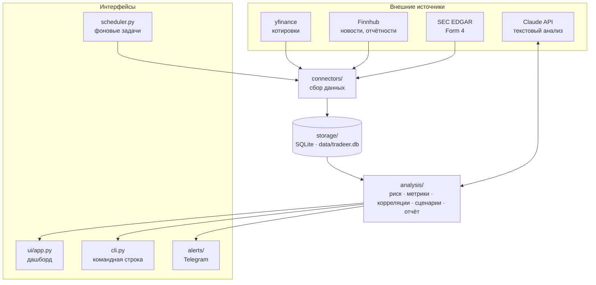

<div align="center">

# 📊 Trading Co-Pilot

**Личный ассистент свинг-трейдера: риск, дисциплина, контекст.**
Только чтение. Не торгует. Не предсказывает цены.


</div>

---

## 🧭 Зачем это

Инструмент ставит не против рынка, а против собственных ошибок трейдера:

- **Риск** — флагует перекосы по позициям и секторам, просадку, скрытую концентрацию через корреляции.
- **Дисциплина** — журнал сделок: тезис, условия входа, тейк-профит и стоп записываются **до** входа.
- **Контекст** — новости, отчётности, сделки инсайдеров (Form 4) и аналитический отчёт Claude.

> [!IMPORTANT]
> Отправка ордеров **навсегда вне рамок проекта**. Весь вывод — это факты и флаги
> относительно заданных вами порогов, а не рекомендации купить или продать.

---

## ✅ Статус

| Фаза | Содержание | Статус |
|:---:|---|:---:|
| 0 | Каркас: настройки, схема SQLite, секреты только из окружения | ✅ |
| 1 | MVP: импорт CSV, котировки yfinance, Risk Engine, журнал сделок, дашборд | ✅ |
| 2 | Информационный слой: Finnhub, SEC Form 4, Telegram-алерты, планировщик | ✅ |
| 3 | Брокер (TraderNet / Freedom Broker KZ), только чтение | ⏳ не начата |
| 4 | Аналитика: метрики риска, корреляции, стресс-тесты, отчёт Claude | ✅ |

---

## 🏗 Архитектура



Каждый источник отключается независимо. Если источник недоступен, приложение
пишет это в лог и продолжает работу с последними известными данными, а не падает.

<details>
<summary><b>📁 Структура файлов</b></summary>

```
tradeer/
├── config/settings.py      типизированные настройки из .env
├── storage/                модели SQLAlchemy и сессия SQLite
├── connectors/
│   ├── market.py           котировки (yfinance)
│   ├── positions.py        импорт позиций из CSV, обновление цен
│   ├── news.py             новости и календарь отчётностей (Finnhub)
│   └── filings.py          сделки инсайдеров Form 4 (SEC EDGAR)
├── analysis/
│   ├── risk.py             Risk Engine: флаги по порогам
│   ├── journal.py          журнал сделок и статистика дисциплины
│   ├── history.py          кэш дневных цен + бенчмарк SPY
│   ├── metrics.py          волатильность, бета, VaR, просадка, Sharpe, Sortino
│   ├── correlations.py     матрица корреляций и скрытые кластеры
│   ├── scenarios.py        стресс-сценарии
│   ├── research.py         слой Claude
│   └── report.py           глубокий отчёт в Markdown
├── alerts/
│   ├── engine.py           правила алертов + дедупликация
│   └── telegram_bot.py     отправка в Telegram
├── ui/app.py               дашборд Streamlit
├── cli.py                  команды для терминала
├── scheduler.py            периодический сбор данных
├── tests/                  pytest
└── sample_data/            пример CSV
```

</details>

---

## 🧰 Технологии

| Задача | Технология |
|---|---|
| Язык | Python 3.14 |
| База данных | SQLite + SQLAlchemy 2 |
| Настройки | pydantic-settings, python-dotenv |
| Расчёты | pandas, numpy |
| Интерфейс | Streamlit (+ matplotlib для тепловой карты) |
| Котировки | yfinance (без ключа) |
| Новости | Finnhub REST API через requests |
| Инсайдеры | SEC EDGAR через requests |
| LLM | Anthropic SDK (Claude) |
| Алерты | Telegram Bot API |
| Расписание | APScheduler |
| Тесты | pytest |

---

## 🚀 Быстрый старт

**1. Окружение** (нужен Python 3.11+):

```powershell
py -m venv .venv
.venv\Scripts\python.exe -m pip install -r requirements.txt
Copy-Item .env.example .env
```

**2. Позиции:** загрузите CSV через боковую панель дашборда или командой:

```powershell
.venv\Scripts\python.exe cli.py import sample_data\positions_sample.csv
```

**3. Дашборд:**

```powershell
.venv\Scripts\python.exe -m streamlit run ui\app.py
```

Откроется на http://localhost:8501. Для базовой работы **ключи не нужны**.

### Формат CSV

```csv
ticker,qty,avg_price,sector
AAPL,20,165.50,Technology
MSFT,10,390.00,Technology
```

Колонки `ticker`, `qty`, `avg_price` обязательны, `sector` — по желанию
(если не указан, подтягивается из yfinance). Поддерживается файл, сохранённый
в Excel как «CSV UTF-8».

> [!WARNING]
> Средняя цена указывается **с учётом сплитов**. Иначе P&L будет искажён:
> например, у NVDA после сплита 10:1 в 2024 году цена до сплита $720 соответствует $72.

---

## 🖥 Дашборд

| Вкладка | Что показывает |
|---|---|
| **Overview** | Стоимость портфеля, нереализованный P&L, таблица позиций, распределение |
| **Risk** | Нарушенные пороги, концентрация по позициям и секторам |
| **Journal** | Запись тезиса до входа, закрытие сделки, статистика дисциплины |
| **News & Events** | Новости, отчётности, Form 4, журнал алертов |
| **Deep Analysis** | Метрики риска, тепловая карта корреляций, стресс-тесты, отчёт Claude |

---

## ⌨️ Команды CLI

| Команда | Действие | Нужно |
|---|---|---|
| `cli.py init-db` | Создать схему базы | — |
| `cli.py import <файл.csv>` | Импорт позиций (`--append` — добавить, а не заменить) | — |
| `cli.py refresh` | Обновить цены и секторы | — |
| `cli.py risk` | Отчёт по риску в терминале | — |
| `cli.py refresh-history` | Загрузить историю дневных цен | — |
| `cli.py news` | Новости и отчётности | `FINNHUB_API_KEY` |
| `cli.py filings` | Сделки инсайдеров Form 4 | `TRADEER_SEC_USER_AGENT` |
| `cli.py alerts` | Запустить проверку алертов | — |
| `cli.py digest` | Краткий дайджест риска от Claude | `ANTHROPIC_API_KEY` |
| `cli.py report [--opinion] [--no-save]` | Глубокий отчёт → `reports/` | ключ Claude — по желанию |

Все команды запускаются как `.venv\Scripts\python.exe cli.py <команда>`.

### Фоновый режим

```powershell
.venv\Scripts\python.exe scheduler.py
```

| Задача | Интервал |
|---|---|
| Проверка алертов | 15 мин |
| Цены | 30 мин |
| Новости и отчётности | 60 мин |
| Form 4 | 6 ч |

---

## ⚙️ Настройки (`.env`)

<details open>
<summary><b>Пороги риска</b></summary>

| Переменная | По умолчанию | Смысл |
|---|:---:|---|
| `TRADEER_MAX_POSITION_PCT` | `0.25` | Флаг, если одна позиция больше этой доли портфеля |
| `TRADEER_MAX_SECTOR_PCT` | `0.40` | Флаг, если один сектор больше этой доли |
| `TRADEER_MAX_DRAWDOWN_PCT` | `0.20` | Флаг, если просадка от пика больше этой величины ⚠️ |

> [!CAUTION]
> Флаг просадки пока **не срабатывает**: Risk Engine умеет его считать, но
> дашборд, CLI и алерты не передают ему историю стоимости портфеля. Метрика
> *Max drawdown* на вкладке Deep Analysis считается отдельно и работает.

</details>

<details>
<summary><b>Источники данных и алерты</b></summary>

| Переменная | По умолчанию | Смысл |
|---|:---:|---|
| `FINNHUB_API_KEY` | — | Новости и календарь отчётностей (бесплатный тариф) |
| `TRADEER_NEWS_LOOKBACK_DAYS` | `7` | За сколько дней загружать новости |
| `TRADEER_EARNINGS_LOOKAHEAD_DAYS` | `14` | На сколько дней вперёд смотреть отчётности |
| `TRADEER_EARNINGS_ALERT_DAYS` | `5` | Алерт, если до отчётности осталось столько дней |
| `TRADEER_SEC_USER_AGENT` | заглушка | SEC требует настоящий контакт: `tradeer/0.1 (ваш@email)` |
| `TELEGRAM_BOT_TOKEN` | — | Токен бота; без него алерты только пишутся в базу |
| `TELEGRAM_CHAT_ID` | — | Куда отправлять алерты |

</details>

<details>
<summary><b>Claude и хранилище</b></summary>

| Переменная | По умолчанию | Смысл |
|---|:---:|---|
| `ANTHROPIC_API_KEY` | — | Включает текстовый анализ, дайджест и отчёт |
| `TRADEER_CLAUDE_MODEL` | `claude-opus-4-7` | Модель; рекомендуется `claude-opus-5-5` |
| `TRADEER_CLAUDE_MAX_TOKENS` | `8000` | Лимит длины ответа |
| `TRADEER_DB_PATH` | `data/tradeer.db` | Путь к файлу базы |

</details>

---

## 📐 Что считается

| Показатель | Как считается |
|---|---|
| Флаги риска | Доля позиции и доля сектора сравниваются с порогами (флаг просадки — см. предупреждение выше) |
| Волатильность, доходность | Годовые, по дневным ценам (252 торговых дня) |
| Бета | Относительно SPY |
| VaR 95% | Исторический (5-й перцентиль) и параметрический (z = 1.645), дневной |
| Max drawdown, Sharpe, Sortino | По истории цен при **текущих** весах портфеля — это оценка, а не фактическая история счёта |
| Скрытые кластеры | Группы бумаг с попарной корреляцией ≥ 0.7 и их суммарный вес |
| Стресс-сценарии | Рынок −10% / −20% / +10% (через бету), сектор −15%, ставки +100 б.п. |

Вся числовая аналитика работает **без ключей**. Claude добавляет только текстовое
описание. Раздел «мнение Claude» по умолчанию выключен, а при включении всегда
идёт с дисклеймером: это информация, а не финансовая рекомендация.

---

## 🔒 Безопасность и данные

- Секреты берутся **только** из `.env` или переменных окружения и не пишутся в лог.
- В `.gitignore` исключены `.env`, базы `*.db`, CSV с позициями и папка `reports/`.
- Все данные хранятся локально в `data/tradeer.db`.
- Наружу уходят только тикеры (yfinance, Finnhub, SEC), а при наличии ключа ещё
  сводные цифры портфеля (Claude).

> [!NOTE]
> Streamlit по умолчанию доступен и из локальной сети. Чтобы открыть дашборд только
> для своего компьютера, добавьте `--server.address 127.0.0.1` к команде запуска.

---

## 🧪 Тесты

```powershell
.venv\Scripts\python.exe -m pytest -q
```

Тесты работают без сети и на временной базе, реальные данные не затрагиваются.

---

## 🛠 Если что-то не работает

| Симптом | Причина и решение |
|---|---|
| `did not find executable at ...python.exe` | Python переустановлен, и venv ссылается на старый путь. Пересоздайте `.venv` (см. «Быстрый старт») |
| `Import matplotlib failed` на вкладке Deep Analysis | Зависимости неполные: `pip install -r requirements.txt` |
| `CSV missing required columns` | Проверьте заголовок: `ticker,qty,avg_price` |
| Finnhub / Claude / Telegram: `off` | Не задан ключ в `.env`. Это не ошибка, источник просто пропускается |
| `Form 4: 0 new` | Все записи уже в базе, дубликаты не добавляются |
| После изменения моделей в коде — ошибки SQL | `create_all` не добавляет колонки в существующие таблицы; удалите `data/tradeer.db` и импортируйте позиции заново |
